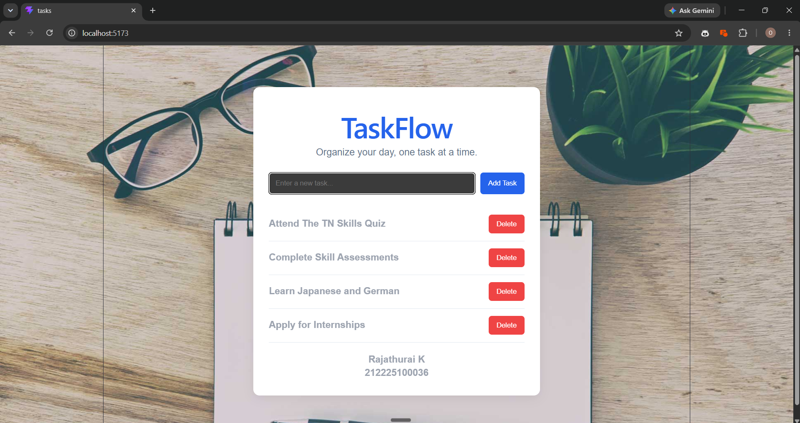

# To-do-list_app

# Ex03 To-Do List using JavaScript
## Date: 17.11.2026

## AIM
To create a To-do Application with all features using JavaScript.

## ALGORITHM
### STEP 1
Build the HTML structure (index.html).

### STEP 2
Style the App (style.css).

### STEP 3
Plan the features the To-Do App should have.

### STEP 4
Create a To-do application using Javascript.

### STEP 5
Add functionalities.

### STEP 6
Test the App.

### STEP 7
Open the HTML file in a browser to check layout and functionality.

### STEP 8
Fix styling issues and refine content placement.

### STEP 9
Deploy the website.

### STEP 10
Upload to GitHub Pages for free hosting.

## PROGRAM

### App.jsx

```

import { useState } from "react";
import "./App.css";

function App() {
  const [tasks, setTasks] = useState([]);
  const [input, setInput] = useState("");

  function addTask() {
    if (input.trim() === "") return;

    const newTask = {
      id: Date.now(),
      text: input,
      completed: false,
    };

    setTasks([...tasks, newTask]);
    setInput("");
  }

  function deleteTask(id) {
    setTasks(tasks.filter((task) => task.id !== id));
  }

  function toggleTask(id) {
    setTasks(
      tasks.map((task) =>
        task.id === id
          ? { ...task, completed: !task.completed }
          : task
      )
    );
  }

  return (
    <div className="app">
      <h1>TaskFlow</h1>
      <p>Organize your day, one task at a time.</p>

      <div className="task-input">
        <input
          type="text"
          placeholder="Enter a new task..."
          value={input}
          onChange={(e) => setInput(e.target.value)}
          onKeyDown={(e) => {
            if (e.key === "Enter") addTask();
          }}
        />

        <button onClick={addTask}>Add Task</button>
      </div>

      <div className="task-list">
        {tasks.length === 0 ? (
          <p>No tasks yet. Add your first task!</p>
        ) : (
          tasks.map((task) => (
            <div className="task" key={task.id}>
              <span
                onClick={() => toggleTask(task.id)}
                className={task.completed ? "completed" : ""}
              >
                {task.text}
              </span>

              <button onClick={() => deleteTask(task.id)}>
                Delete
              </button>
            </div>
          ))
        )}
      </div>
      <footer color="blue" style={{marginTop:"20px", fontWeight:"bold"}}>
      Rajathurai K<br></br>
      212225100036
    </footer>
    </div>
    
  );
}

export default App;

```

### App.css

```

* {
  box-sizing: border-box;
}

body {
  margin: 0;
  font-family: Arial, sans-serif;
  background-image: url('assets/bg.png');
  background-size: cover;
}

.app {
  width: 90%;
  max-width: 550px;
  margin: 80px auto;
  padding: 30px;
  background: white;
  border-radius: 12px;
  box-shadow: 0 5px 20px rgba(0, 0, 0, 0.08);
}

h1 {
  color: #2563eb;
  margin-bottom: 25px;
}

.app p {
  color: #64748b;
}

.task-input {
  display: flex;
  gap: 10px;
  margin: 25px 0;
}

.task-input input {
  flex: 1;
  min-width: 0;
  padding: 12px;
  border: 1px solid #cbd5e1;
  border-radius: 6px;
}

button {
  padding: 10px 15px;
  border: none;
  border-radius: 6px;
  background: #2563eb;
  color: white;
  cursor: pointer;
}

button:hover {
  background: #1d4ed8;
}

.task {
  display: flex;
  justify-content: space-between;
  align-items: center;
  gap: 12px;
  padding: 14px 0;
  border-bottom: 1px solid #e2e8f0;
}

.task span {
  cursor: pointer;
  overflow-wrap: anywhere;
}

.completed {
  text-decoration: line-through;
  color: #94a3b8;
}

.task button {
  background: #ef4444;
}

.task button:hover {
  background: #dc2626;
}

.task-list {
  font-weight:bolder;
}
```


## OUTPUT




## RESULT
The program for creating To-do list using JavaScript is executed successfully.
